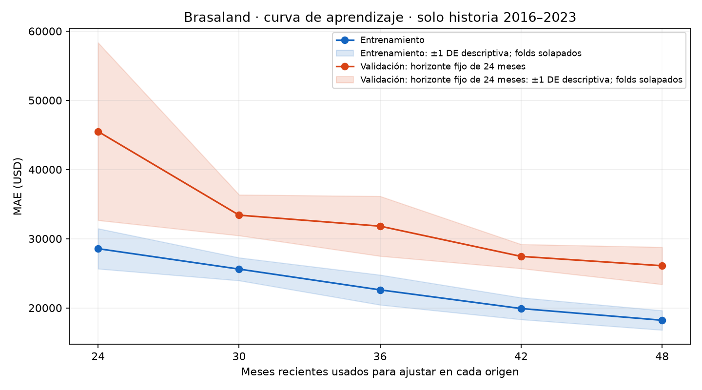
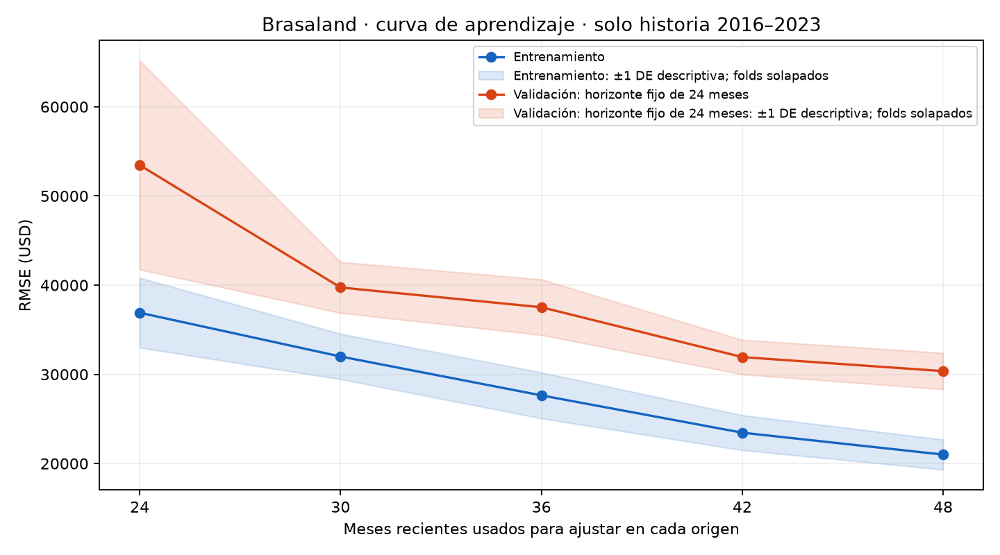

# Evaluación de un Modelo de Regresión — Brasaland

## Método y contexto

Continuación de PR #26 (`0b0b705`). Se reutiliza `TrendForest` sin cambiarlo:
tendencia lineal más RandomForestRegressor de residuos estacionales, calendario,
300 árboles, profundidad 3, mínimo 3 por hoja y semilla 42. **No tiene lags ni
medias móviles**; esta diferencia con la consigna genérica se conserva porque
evaluamos el modelo existente, sin adaptar la clase a `learning_curve`.

Objetivo: `revenue_usd`, ingresos mensuales consolidados de 14 sedes en USD.
Rige el [contexto específico de ventas](../../docs/sales-forecasting/CONTEXT-brasaland.en.md);
el documento general en español describe incidentes. El CSV oficial permanece
intacto: no se generan datos ni se suman monedas diferentes.

Se descarta 2024–2025 antes de derivar estadística alguna. Solo se usan los 96
meses de 2016–2023: cinco orígenes tras 48, 54, 60, 66 y 72 meses, entrenamiento
expansivo anterior al origen y validación de **24 meses**. Tendencia y forest
nuevos en cada ajuste. Predicciones emitidas simultáneamente, sin ver ventas
intermedias. Todas las validaciones terminan antes de 2024. Baseline: repetir
los últimos 12 meses observados para los dos años futuros. No hay selección
de parámetros con validación o test, imputación ni escalado nuevo.

Las validaciones se solapan: 120 posiciones evaluadas pero solo 48 meses
distintos de 2020–2023. Cada fold tiene el mismo peso. **Media ± DE muestral,
`ddof=1`, es dispersión descriptiva**, no intervalo de confianza ni cinco
réplicas independientes. No se usa un splitter aleatorio o con otro horizonte.

## Métrica principal y negocio

**RMSE es principal**: penaliza más los errores grandes que pueden producir
faltantes, compras urgentes o exceso de ingredientes perecederos y desperdicio
en picos de ventas. MAE acompaña como error monetario absoluto promedio para
planificación. Los errores de ingresos en USD no son costes de ingredientes;
faltan márgenes y recetas para traducirlos a compras.

El contexto no fija costes de sobreestimar frente a subestimar. No se inventa
una función de costes ni se afirma qué dirección es más cara. Error firmado =
predicción − real: negativo = subestimación, positivo = sobreestimación; puede
cancelar errores opuestos y no reemplaza MAE/RMSE.

## Resultados por fold (USD)

| Origen (meses) | Entrenamiento: fechas / n | Validación: fechas / n | Train MAE | Train RMSE | Val MAE | Val RMSE | Baseline MAE | Baseline RMSE | Error firmado val |
| --- | --- | --- | ---: | ---: | ---: | ---: | ---: | ---: | ---: |
| 48 | 2016-01-01–2019-12-01 / 48 | 2020-01-01–2021-12-01 / 24 | 16,039.79 | 18,613.62 | 29,882.81 | 33,640.17 | 42,300.34 | 51,250.92 | 12,863.03 |
| 54 | 2016-01-01–2020-06-01 / 54 | 2020-07-01–2022-06-01 / 24 | 16,571.76 | 19,326.43 | 22,947.91 | 28,672.49 | 51,381.70 | 58,491.10 | -5,000.45 |
| 60 | 2016-01-01–2020-12-01 / 60 | 2021-01-01–2022-12-01 / 24 | 15,879.43 | 18,146.28 | 23,505.86 | 25,497.26 | 47,431.08 | 53,729.34 | 6,141.13 |
| 66 | 2016-01-01–2021-06-01 / 66 | 2021-07-01–2023-06-01 / 24 | 16,149.92 | 18,515.84 | 21,693.13 | 25,014.08 | 46,508.86 | 57,135.51 | -3,543.99 |
| 72 | 2016-01-01–2021-12-01 / 72 | 2022-01-01–2023-12-01 / 24 | 16,207.78 | 18,696.16 | 22,590.69 | 26,464.80 | 52,488.59 | 64,139.82 | -2,092.27 |

| Partición | MAE media ± DE (USD) | RMSE media ± DE (USD) | Error firmado media ± DE (USD) |
| --- | ---: | ---: | ---: |
| Entrenamiento | 16,169.74 ± 257.21 | 18,659.66 ± 427.86 | -305.20 ± 142.21 |
| Validación | 24,124.08 ± 3,285.93 | 27,857.76 ± 3,524.87 | 1,673.49 ± 7,601.16 |
| Baseline en validación | 48,022.11 ± 4,080.88 | 56,949.34 ± 4,923.29 | -45,759.20 ± 5,108.74 |

## Curvas de aprendizaje

Últimos 24, 30, 36, 42 y 48 meses anteriores a **cada mismo origen**. Las cinco
ventanas de validación no cambian al variar tamaño. 48 es el máximo común
porque el primer origen solo tiene 48 meses disponibles. Se mezclan longitud
y recencia de historia; con 30/42 meses cambia la cobertura relativa de las
temporadas. No es muestreo aleatorio ni la misma construcción expansiva de CV.

| Meses de ajuste | Train MAE ± DE | Val MAE ± DE | Train RMSE ± DE | Val RMSE ± DE |
| ---: | ---: | ---: | ---: | ---: |
| 24 | 28,559.05 ± 2,909.40 | 45,497.34 ± 12,836.24 | 36,907.80 ± 3,918.68 | 53,454.06 ± 11,706.00 |
| 30 | 25,605.05 ± 1,656.05 | 33,404.00 ± 2,950.31 | 31,996.38 ± 2,546.16 | 39,736.70 ± 2,853.72 |
| 36 | 22,601.06 ± 2,165.69 | 31,814.56 ± 4,324.42 | 27,638.14 ± 2,578.84 | 37,522.86 ± 3,114.95 |
| 42 | 19,902.81 ± 1,578.58 | 27,442.94 ± 1,745.41 | 23,455.95 ± 1,962.04 | 31,932.09 ± 1,929.95 |
| 48 | 18,210.46 ± 1,410.28 | 26,091.69 ± 2,691.12 | 20,998.83 ± 1,684.00 | 30,362.65 ± 2,040.67 |





De 24 a 48 meses, RMSE de validación cae **43.20%**; también cae
el error de entrenamiento. En CV expansiva, comparar orígenes no aísla tamaño:
cambian período validado y nivel de ingresos. Las curvas fijan las ventanas
para complementar esa comparación.

## Diagnóstico y acción

**Diagnóstico: Underfitting estructural provisional de la estacionalidad creciente.**

Ambas curvas mejoran con más historia y todos los errores de diciembre en validación son negativos. La tendencia crece, pero el forest de calendario aprende un efecto aditivo fijo sin interacción con el nivel temporal. Este patrón es compatible con sesgo estructural de amplitud estacional y estimación de tendencia con poca historia, no una prueba de sobreajuste generalizado. La clasificación es provisional: las curvas no separan causalmente sesgo y varianza por sí solas.

Error medio de diciembre: entrenamiento **-21,553.30 USD**,
validación **-48,083.14 USD**. Los 10 residuos de diciembre de los
folds incluyen meses repetidos. La brecha train/validación debe interpretarse
junto al crecimiento y cambio temporal; por sí sola no demuestra overfitting.

**Acción concreta:** Evaluar una variante multiplicativa: ajustar tendencia solo dentro de cada fold y entrenar el forest sobre ingreso/tendencia − 1, reconstruyendo ingreso como tendencia × (1 + residuo relativo predicho). Esto permitiría crecer la amplitud estacional con el nivel de ventas. No se implementa la corrección ni se promete mejora en esta tarea de evaluación.

**Verificación propuesta:** comparar la variante con el modelo actual en los
mismos cinco orígenes de 24 meses y tamaños de las curvas, reajustando desde
cero y aprendiendo cada transformación solo con su entrenamiento. Exigir menor
RMSE medio sin empeorar MAE y menor magnitud del error de diciembre, registrando
cada fold y su dispersión. Una corrección seleccionada necesitará una validación
futura independiente. **No reutilizar el test 2024–2025 ya reportado en #26.**

## Limitaciones

Serie pequeña educativa, generada previamente por la academia: no valida
rendimiento en ventas reales. Folds solapados, historia compartida y pocas
temporadas; la dispersión sombreada no es un intervalo de confianza. Sin
costes asimétricos, detalle por sede o conversión COP→USD original auditable.
No se cambia el modelo ni se promete precisión de una corrección no probada.

## Reproducción y artefactos

Desde la raíz:

```bash
uv sync --project experiments/sales_forecasting --frozen
uv run --project experiments/sales_forecasting --frozen python scripts/evaluate_sales_model.py
uv run --project experiments/sales_forecasting --frozen pytest tests/pipelines/test_sales_forecasting.py tests/pipelines/test_sales_model_evaluation.py -q
```

El entrypoint regenera este informe, [métricas](sales_forecasting/evaluation/metrics.json),
[folds](sales_forecasting/evaluation/cv_scores.csv), [valores de curvas](sales_forecasting/evaluation/learning_scores.csv),
[predicciones CV](sales_forecasting/evaluation/cv_predictions.csv),
[predicciones de curvas](sales_forecasting/evaluation/learning_predictions.csv) y las dos figuras.
Admite `--dataset`, `--output` y `--report`. No sobrescribe los artefactos de #26.
