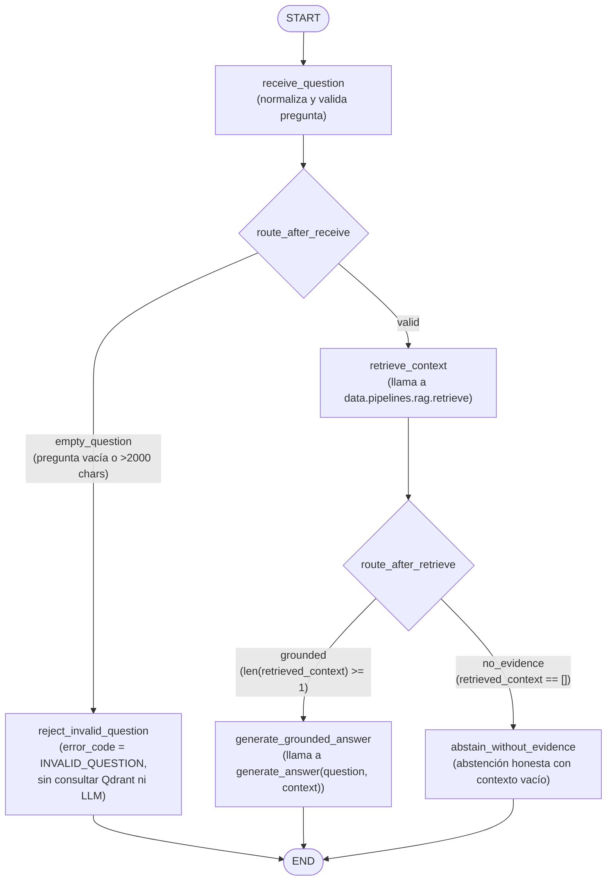

# Agente de Soporte con LangGraph — Parte 1: Migración y Flujo del Agente

## 1. Objetivo y Alcance
Esta primera parte migra el flujo RAG de Brasaland a una máquina de estados explícita y trazable con **LangGraph** dentro del backend activo (`services/api/app/domains/agent/`), reutilizando sin duplicación las funciones [`retrieve()`](../../data/pipelines/rag.py) y [`generate_answer()`](../../data/pipelines/rag.py) de `data/pipelines/rag.py` y manteniendo intacto el endpoint previo `POST /knowledge/query`.

## 2. Arquitectura del Grafo y Contrato de Nodos



- **Estado mínimo y tipado ([`state.py`](../../services/api/app/domains/agent/state.py))**:
  - `AgentState(TypedDict, total=False)` define únicamente: `run_id`, `question`, `retrieved_context`, `answer`, `route` y `error_code`.
  - `validate_agent_state()` valida invariantes en cada transición y rechaza explícitamente historiales conversacionales (`messages`, `history`), credenciales (`api_key`, `token`, `authorization`) y clientes HTTP/BD (`client`, `store`).
- **Nodos independientes ([`graph.py`](../../services/api/app/domains/agent/graph.py))**:
  - `receive_question`: normaliza la pregunta y decide `valid` vs `empty_question`.
  - `reject_invalid_question`: corta la ejecución ante preguntas vacías o fuera de rango sin tocar Qdrant ni el modelo generativo.
  - `retrieve_context`: importa y ejecuta `retrieve(question, k=5, min_score=cfg.min_score, config=cfg)` desde `data.pipelines.rag`.
  - `generate_grounded_answer`: importa y ejecuta `generate_answer(question, state["retrieved_context"], config=cfg)` recibiendo exactamente el contexto recuperado por `retrieve_context`.
  - `abstain_without_evidence`: ruta condicional explícita cuando `retrieve_context` devuelve `[]` (ningún chunk supera `RAG_MIN_SCORE=0.60`), produciendo una abstención honesta sin inventar políticas.
  - **Compilación explícita**: `COMPILED_AGENT_GRAPH = build_agent_graph(checkpointer=DEFAULT_CHECKPOINTER)` compila el grafo al cargar el módulo. Nunca se invoca el `query()` monolítico dentro del grafo.

## 3. Checkpoints y Traces Consultables

- **Checkpointing por corrida/hilo**:
  - Se utiliza `InMemorySaver` de `langgraph.checkpoint.memory` con un `thread_id` aislado por corrida (`config={"configurable": {"thread_id": thread_id}}`), evitando mezclar estados entre usuarios o solicitudes concurrentes.
  - Las funciones [`get_run_state(thread_id)`](../../services/api/app/domains/agent/graph.py) y [`get_run_checkpoints(thread_id)`](../../services/api/app/domains/agent/graph.py) permiten inspeccionar el snapshot actual (`graph.get_state(...)`) y el historial completo de transiciones (`graph.get_state_history(...)`) con sus `checkpoint_id`, `step`, `source` y `next`.
- **Traces persistidos en disco ([`traces.py`](../../services/api/app/domains/agent/traces.py))**:
  - Cada corrida de `execute_agent_query()` escribe un archivo JSON consultable en `AGENT_TRACES_DIR/<run_id>.json` (por defecto `services/api/data/agent_traces/<run_id>.json`, ignorado en Git).
  - Registra operaciones observables: `run_id`, `thread_id`, `started_at`, `finished_at`, `status`, `route`, `question`, `nodes_order`, `steps` (con `duration_ms`, `retrieved_count` y fuentes `{source_document, section, chunk_index}`), `checkpoints`, `retrieved_context`, `answer` y `error` sanitizado (sin tokens, claves ni stack traces).
  - Export de corrida real contra Qdrant + Google Gemini incluido en [`data/eval/langgraph-agent-trace-01.json`](../../data/eval/langgraph-agent-trace-01.json).

## 4. Endpoint `POST /agent/query`

- Implementado en [`services/api/app/domains/agent/router.py`](../../services/api/app/domains/agent/router.py) y registrado en [`services/api/app/main.py`](../../services/api/app/main.py).
- Protegido con `Depends(get_current_user)`, convive sin conflictos con `POST /knowledge/query`, recibe `{"question": "..."}` y devuelve `{"answer": "..."}`.
- Sanitiza fallos internos (`ConfigurationError` $\rightarrow$ 503, `ProviderError` $\rightarrow$ 502, `StoreError`/`RagError` $\rightarrow$ 503, `InvalidQuestionError` $\rightarrow$ 422) sin exponer detalles internos.

## 5. Evaluaciones Reproducibles (`tests/pipelines/test_agent_evals.py`)

Se ejecutan con un solo comando sin requerir llamadas en vivo al LLM en cada corrida:

```bash
uv run --project services/api --extra dev python -m pytest tests/pipelines/test_rag.py tests/pipelines/test_agent_evals.py -v
```

- **Eval 1 (`test_eval_01_nominal_flow_and_node_order_from_saved_traces`)**: comprueba en fixtures y en el trace real exportado que `nodes_order == ["receive_question", "retrieve_context", "generate_grounded_answer"]`, que `retrieve_context` precede a la generación y que los checkpoints registran todas las transiciones hasta `next == []`.
- **Eval 2 (`test_eval_02_conditional_alternative_routes_from_saved_traces`)**: comprueba las dos rutas condicionales alternativas (`receive_question -> reject_invalid_question` sin consultar Qdrant ante pregunta vacía, y `receive_question -> retrieve_context -> abstain_without_evidence` cuando `retrieved_context == []`).
- **Eval 3 (`test_eval_03_brasaland_grounding_on_saved_and_real_traces`)**: comprueba que tanto el contexto recuperado como la respuesta generada conservan las políticas exactas de Brasaland (Nivel Oro `50+ puntos` y `15%` de descuento permanente en `loyalty-program`; advertencia de `contaminación cruzada` y ausencia de versión `sin gluten` certificada de la Costilla BBQ en `menu-allergens`).
