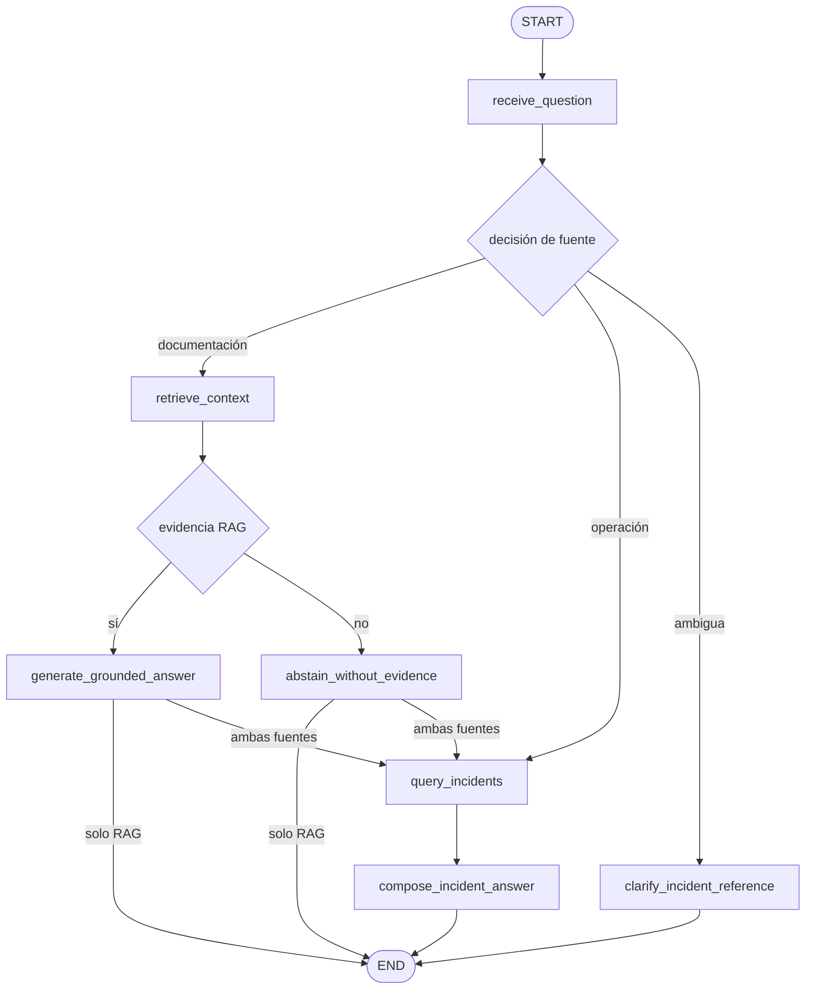

# Agente de Soporte con LangGraph — Parte 2: Herramientas Fuera del RAG

## Diseño

El agente conserva el grafo compilado de la Parte 1 y añade una decisión de
fuente después de recibir la pregunta:



La decisión usa intención operativa (estado, seguimiento, recuentos, filtros
vigentes) junto con el contexto de incidencias o un ID interno. Preguntas sobre
políticas, puntos, alérgenos y procedimientos van al RAG. Si se solicitan datos
operativos y documentación, se consultan ambas fuentes y se presentan en
secciones distintas. `retrieve()` y `generate_answer()` siguen siendo nodos
separados; el grafo no llama al `query()` monolítico.

Una referencia numérica corta como `482` no se convierte en ID ni en
`external_ref`: el agente pide el ID interno de 12 caracteres hexadecimales.
Las listas sólo admiten los filtros reales de la API (`status`, `category`,
`branch`); sin filtros, el endpoint existente permite una consulta general.
No se accede a inventario.

## Transporte, autenticación y privacidad

La herramienta tipada `IncidentToolInput`/`IncidentToolResult` hace sólo
`GET /api/incidents` o `GET /api/incidents/{incident_id}` con `httpx`. La URL
base se configura en el entorno del servidor como `INCIDENTS_SERVICE_URL` y
nunca se deriva de la pregunta o de una salida del modelo. Se configura con la
URL base del servicio (por ejemplo `http://127.0.0.1:8000` en desarrollo).

`POST /agent/query` conserva `Depends(get_current_user)`. La misma credencial
Bearer que ya fue validada se reenvía durante la llamada GET; el servicio
revalida el token y el estado activo del usuario. No se añade una credencial
de servicio ni se hardcodea un token. La credencial sólo existe como argumento
local de la ejecución: no entra al estado, los checkpoints, ni los traces.
`httpx` recibe un timeout explícito de **5.0 segundos**, no sigue redirects y
no registra bodies ni detalles de errores remotos.

El resultado distingue `success`, `not_found`, `permission_denied`, `timeout`,
`unavailable` y `ambiguous`. El resumen expuesto al agente contiene ID,
categoría, estado, sucursal, fechas, origen y referencia externa. Se descartan
`title` y `description`: son contenido no confiable y nunca se envían al modelo
ni se tratan como instrucciones. Los traces guardan sólo la fuente, los nodos,
el resultado categórico y el fallback; no guardan la pregunta ni identificadores
de incidencia, y almacenan la longitud de pregunta en su lugar.

## Fallback

Una referencia ambigua produce una solicitud de aclaración sin consultar una
fuente. Timeout, falta de permisos, recurso inexistente o servicio no disponible
producen una respuesta explícita, sin consultar el RAG para aparentar una
confirmación. En una pregunta combinada, la respuesta documental se conserva
separada de la respuesta operativa; el fallo de la herramienta se muestra en la
sección operativa y se marca `fallback=true` en el trace.

## Pruebas y ejecución reproducible

Pruebas dirigidas (mocks HTTP y `InMemorySaver`/`tmp_path`):

```bash
uv run --project services/api --extra dev python -m pytest \
  tests/pipelines/test_agent_evals.py \
  tests/pipelines/test_rag.py \
  services/api/tests/test_agent_api.py -q
```

Para una verificación real, iniciar el backend con su configuración normal de
RAG y el servicio de incidentes existente; configurar `INCIDENTS_SERVICE_URL`
en el entorno del backend y obtener un token de sesión válido mediante el flujo
de autenticación del proyecto. No colocar tokens en comandos versionados ni en
traces. Desde la raíz:

```bash
export ACCESS_TOKEN='<token obtenido localmente>'
curl -fsS http://127.0.0.1:8000/agent/query \
  -H "Authorization: Bearer $ACCESS_TOKEN" \
  -H 'Content-Type: application/json' \
  -d '{"question":"¿En qué estado está la incidencia <ID_INTERNO_REAL>?"}'
curl -fsS http://127.0.0.1:8000/agent/query \
  -H "Authorization: Bearer $ACCESS_TOKEN" \
  -H 'Content-Type: application/json' \
  -d '{"question":"¿Cuántos puntos necesito para Oro?"}'
```

Los traces sanitizados se escriben en `AGENT_TRACES_DIR` (por defecto
`services/api/data/agent_traces/`, ignorado por Git). Ejecutar los comandos de
pytest anteriores exporta el resultado de evaluaciones en la salida estándar.
Los tests verifican ruta operacional sin RAG, ruta RAG sin herramienta,
timeout/servicio no disponible/no encontrado, aclaración de ID ambiguo y
consulta combinada.

## Estado de publicación

La suite dirigida se ejecutó con **94 passed**, incluyendo los evals nuevos;
son verificaciones con mocks y no representan consultas reales. No se generaron
traces reales porque este entorno no tiene credenciales/configuración de
incidencias ni del proveedor RAG. Los traces/evals encontrados bajo `data/eval/`
están bloqueados por la política de exclusión y no se intentó acceder a ellos
por otras vías. La publicación también requiere sesión GitHub: `gh auth status`
no encuentra una sesión y el `git push --dry-run` no puede autenticarse. Por
ello, la rama y la PR con la etiqueta `langgraph-external-tools` quedan
pendientes de habilitar esos accesos y adjuntar los traces sanitizados exigidos.
