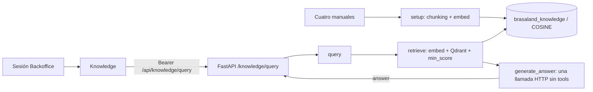

# Diseño — RAG y Base de Conocimiento de Brasaland

## Estado y fuentes

Sesión del 14–15 de octubre de 2026 (America/Mexico_City). Rama conservada `feature/rag-knowledge-base`, dos commits RAG sobre `origin/main` local `810a873`; cambios de cierre sin commit. Se conserva `backup/rag-knowledge-base-pr27` y ambos stashes. No hubo cherry-picks nuevos, publicación ni incorporación de ventas/Redis/Celery. El árbol tenía cambios locales al iniciar y sigue con ellos.

El contexto contractual es `docs/rag/CONTEXT-brasaland.es.md`, revisión `bc4c7c86e09cc336317c7acba5a41a108925f4bb`. Los cuatro manuales de `docs/company-knowledge-base/` conservan íntegro el corpus fijado en `48e21bb4c45a4101abb09cff8e6e0ad941c87847`. No se indexa el contexto histórico de incidentes, contextos generales ni otros archivos. No se modificaron los manuales.

**Proveedor confirmado por el usuario: Perplexity directo.** Falta provisionar las claves locales y seleccionar el modelo de generación habilitado en su cuenta. La implementación y pruebas offline están verificadas; indexación, consulta y evaluación con modelos reales siguen pendientes. No hay Recall ni fidelidad reales medidos.

## Flujo y contratos



- `setup()` carga la allowlist, calcula embeddings y hace upsert con UUIDv5 estables. Borra sólo chunks obsoletos de la misma empresa/idioma/fuente, con paginación.
- `embed(text)` conserva el texto tal cual (`identity-v1`) y devuelve `list[float]` finita, no vacía, no nula y de dimensión configurada. Es el mismo adaptador para manuales y consultas.
- `retrieve(query, *, k=5, min_score)` devuelve 0..k resultados. Usa `query_points`, umbral explícito entre −1 y 1, empresa/idioma/revisión/allowlist y configuración vectorial. Un score no es probabilidad.
- `generate_answer(question, context)` llama al modelo también con contexto vacío; nunca sustituye su salida por un fallback local presentado como generado.
- `query(question)` compone recuperación y generación. `build_context` se comparte con el evaluador; la respuesta es texto, no chunks.
- `POST /knowledge/query` mantiene autenticación existente y contrato público `{"answer":"..."}`. Fallos de proveedor, salida malformada, incompatibilidad de colección o rechazo de grounding producen 503 genérico, sin detalles internos.

`services/api` sigue siendo la API activa. No se añaden APIs en UI, frameworks RAG, SDKs, workers ni orquestación de agentes. Se reutiliza `httpx` y el cliente Qdrant existente.

## Contratos HTTP confirmados por documentación

Referencias consultadas en esta sesión:

- [Embeddings API](https://docs.perplexity.ai/api-reference/embeddings-post): `/v1/embeddings`, Bearer, modelo estándar, `dimensions`, `encoding_format: base64_int8`.
- [Quickstart y COSINE](https://docs.perplexity.ai/docs/embeddings/quickstart) y [decodificación signed INT8](https://docs.perplexity.ai/docs/embeddings/standard-embeddings).
- [Generación vigente](https://docs.perplexity.ai/api-reference/agent-post): `/v1/agent`, `input`, `instructions`, `max_output_tokens`, salida tipada `output`.
- [Migración de Sonar](https://docs.perplexity.ai/docs/agent-api/migrate-from-sonar/overview): no tratar el endpoint legacy como un contrato idéntico ni asumir que un prompt desactiva búsqueda.

**Embedding Perplexity:** se solicita expresamente `base64_int8`. La decodificación usa base64 validado y convierte bytes 128..255 a −128..−1; nunca interpreta uint8 ni acepta listas float/binary silenciosamente. Comprueba longitud/dimensión y vector no nulo. Los modelos estándar documentados son `pplx-embed-v1-0.6b` (128..1024 dimensiones) y `pplx-embed-v1-4b` (128..2560). El ejemplo local usa el primero a 1024; disponibilidad y dimensión devuelta se confirman mediante smoke real antes de indexar.

**Generación Perplexity:** una llamada con modelo explícito `creator/model`, sin preset, `tools: []`, `tool_choice: "none"`, `max_steps: 1`, `stream: false`, `store: false`. Aunque el proveedor llama a este endpoint Agent API, la aplicación sólo solicita una inferencia sin herramientas ni bucles. No hay búsqueda web, URL fetch, skills ni enriquecimiento. No se envía `temperature`: este contrato no la documenta. Se exige `status: completed`; se extraen sólo mensajes assistant/output_text. Se rechazan herramientas, estados incompletos, citas externas, errores y respuestas vacías; razonamiento interno no se expone. El ID habilitado se obtiene con `python -m data.process.smoke --list-generation-models`, sin inventar un modelo.

**Proxy 4Geeks:** no hay contrato ni acceso confirmado y no es el proveedor elegido. El modo explícito `openai_compatible` sólo sirve para un proxy cuyo responsable haya confirmado Bearer opcional, rutas `/embeddings` y `/chat/completions`, floats y ausencia de búsqueda del lado servidor. No se le imponen parámetros INT8/dimensión de Perplexity. Una forma JSON parecida no prueba compatibilidad. Si el contrato real difiere, se necesita otro adaptador pequeño antes de usarlo; no hay fallback automático.

La integración del editor no proporciona claves a la aplicación. Las URLs no admiten userinfo/query/fragment para evitar secretos en configuración persistida. Errores y timeouts no se convierten en respuestas exitosas; las pruebas usan `httpx.MockTransport`, sin llamadas externas.

## Colección, payload y compatibilidad

Colección exacta `brasaland_knowledge`, distancia COSINE. Cada punto contiene empresa, fuente, sección, idioma, índice y texto, más hash de fuente, revisión del corpus y `embedding_configuration` con proveedor, endpoint sin secretos, modelo, dimensión, codificación y preprocesamiento. No se almacenan claves.

Antes de escribir o consultar se verifican esquema, dimensión y metadata de todos los puntos mediante scroll paginado. Un modelo o codificación diferente con la misma dimensión también falla. Una colección antigua sin metadata exige migración explícita; **no se borra, recrea ni adopta automáticamente**. Setup prepara los vectores antes de escribir y comprueba de nuevo la compatibilidad. La consulta nunca crea una colección.

Chunking local sin cambios: lealtad 5, desperdicio 5, alérgenos 4, proveedores 4; total **18**. Esto es conteo del corpus procesado, no prueba de indexación con modelos reales.

## Política de grounding y límites

El prompt pide español, voz de vendedor entrenado, cifras/monedas/condiciones originales, citas de fuente, ausencia de conversión y advertencias de alérgenos. Pregunta y contexto viajan como JSON de datos no confiables bajo instrucciones separadas. Una prueba HTTP de payload no demuestra resistencia semántica; el evaluador conserva una prueba adversarial real pendiente.

Si el contexto está vacío se instruye una frase de insuficiencia sin otros hechos. La respuesta sigue siendo la del modelo: un control conservador sólo acepta una frase explícita de insuficiencia dentro de las variantes permitidas; cualquier ampliación se rechaza. El guard cuantitativo compara tokens numéricos completos, signos, unidades y formato literal contra el contexto. El control de alérgenos rechaza promesas de “sin riesgo”, “cero riesgo” o “riesgo cero”; permite una negación explícita de garantía. Un rechazo lanza `GroundingValidationError` y termina en 503, sin reemplazar la respuesta por texto atribuido al modelo.

Estos controles son léxicos y conservadores: pueden rechazar paráfrasis válidas y no prueban relaciones entre cifra/moneda/condición, veracidad de toda afirmación cualitativa ni seguridad absoluta frente a prompt injection. La revisión humana separada sigue siendo necesaria, especialmente para trazas de maní, contaminación cruzada y Costilla BBQ sin versión sin gluten certificada. No presentar estos filtros como evaluación de fidelidad aprobada.

## Entorno y ejecución

Variables y plantilla: `services/api/.env.example`. Configurar sólo en archivo local ignorado o gestor de secretos:

```dotenv
EMBEDDING_PROVIDER=perplexity
EMBEDDING_API_BASE_URL=https://api.perplexity.ai/v1
EMBEDDING_MODEL=pplx-embed-v1-0.6b
EMBEDDING_DIMENSIONS=1024
EMBEDDING_ENCODING_FORMAT=base64_int8
EMBEDDING_API_KEY=
GENERATION_PROVIDER=perplexity
GENERATION_API_BASE_URL=https://api.perplexity.ai/v1
GENERATION_MODEL=
GENERATION_API_KEY=
QDRANT_URL=http://qdrant:6333
KNOWLEDGE_MIN_SCORE=
```

Completar ambas claves localmente, ID de generación habilitado y umbral tras calibración; no enviar claves al chat. Timeouts por defecto 30s/45s y límite de salida 500 tokens, configurables. `GENERATION_TEMPERATURE` sólo se envía al modo compatible. Compose requiere además los `DATABASE_URL` y `SECRET_KEY` válidos ya usados por la API.

Qdrant v1.19.2 conserva volumen nombrado y puerto sólo interno; el cliente sigue en 1.19.1, lock sincronizado. Backend monta el corpus read-only y `data/` en `/monorepo`, separado de TinyDB. El contexto de build incluye `data/process`, pipelines y evaluador; excluye secretos, dependencias y tests. Ver [procedimiento real pendiente](rag-evaluation-report.md) para discovery, smoke, doble setup y evaluación.

## Backoffice y verificación

`/backoffice/knowledge` reutiliza AuthGuard, sesión y Bearer; presenta carga accesible, bloqueo de doble envío, error, reintento con pregunta preservada y respuesta como texto. Cliente valida JSON nulo/malformado y errores no textuales. No presenta chunks, vectores ni scores.

La suite frontend usa sesión/HTTP simulados; no es E2E real. Se comprobaron contra `810a873` los tres errores de typecheck en auth/telemetría, sin modificar esos módulos. El build de rama y base se detiene antes, descargando Google Fonts. Resultados, limitaciones y comandos están en [el informe](rag-evaluation-report.md) y el walkthrough.
