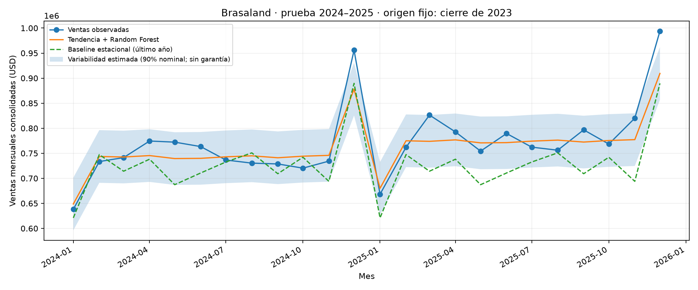

# Predicción de Ventas con un Modelo de Regresión — Brasaland

## Entrega y procedencia

Experimento offline reproducible, apilado sobre PR #25
(`feature/dev-55-celery-async-tasks`, base `96e75cd`). No modifica ni fusiona esa PR.
El modelo no se incorpora a la API ni a Celery: sus dependencias y lockfile viven
exclusivamente en `experiments/sales_forecasting/`.

El CSV se obtuvo del **material oficial de 4Geeks**, no se creó ni regeneró:
[CSV fijado a commit](https://raw.githubusercontent.com/4GeeksAcademy/ai-engineering-syllabus/2869fa3d9a89b820aab4b8f6adaaadd63d37e530/content/contexts/sales-forecasting/brasaland/brasaland_sales.csv).
La copia sugerida por el usuario en `Rickycastro1940/python-hello` tiene exactamente
las mismas filas; difieren los saltos de línea. Se conserva el archivo oficial
byte por byte, SHA-256 `a3e082d2a7161ef03b97c681e80083d952c6fc2629b54bfe994f144660fa130d`.
URLs, revisiones y hashes del CSV y contexto figuran en [source.json](source.json).

El [contexto oficial de forecasting](CONTEXT-brasaland.en.md) se conserva como
referencia separada. `CONTEXT.md` aporta el briefing general;
`docs/CONTEXT-brasaland.es.md` describe **incidentes**, no el esquema de ventas.
El contexto oficial indica que el dataset fue generado previamente con semilla
42 para el curso: estos resultados son educativos y **no validan ventas reales**.

## Esquema, objetivo y moneda

120 observaciones mensuales, enero 2016–diciembre 2025, una por mes, sin valores
faltantes ni meses duplicados. Se ordenan por fecha antes de cualquier ajuste.

| Columna | Significado oficial | Uso |
| --- | --- | --- |
| `month` | Primer día del mes, `YYYY-MM-01` | Calendario y partición |
| `revenue_usd` | Ventas mensuales consolidadas de los 14 locales en USD | Objetivo |
| `covers_served` | Comensales mensuales de toda la cadena | Excluida del predictor |
| `avg_ticket_usd` | Ticket medio mensual en USD | Excluida del predictor |
| `market` | Mercado; todas las filas disponibles son `consolidated` | Validación |

El CSV ya viene consolidado en USD. No sumamos COP con USD ni hacemos conversiones
nuevas. El contexto propone una tasa fija COP→USD (ejemplo: 4.000 COP/USD), pero
el archivo no contiene los importes originales ni la tasa efectivamente aplicada;
no se puede auditar esa consolidación. No permite resultados por sede o país.

El material describe crecimiento anual alternante del 3%/7%, caída de enero y
pico de diciembre. Se conserva esta estacionalidad; no se reescriben los datos.

## Predicción, algoritmo y ausencia de fuga

**Promesa evaluada:** desde el cierre de diciembre de 2023, emitir simultáneamente
24 predicciones mensuales para enero de 2024–diciembre de 2025, sin observaciones
intermedias, actualización ni reajuste del modelo.

Entrenamiento exclusivamente **2016–2023 (96 meses)**. Prueba exclusivamente
**2024–2025 (24 meses)**. No se eligió algoritmo, hiperparámetros ni banda usando
las respuestas de estos dos últimos años.

Se utiliza una tendencia lineal en el índice mensual ajustada con entrenamiento,
más `RandomForestRegressor` sobre sus residuos estacionales. Un forest puro no
extrapola la tendencia creciente más allá de lo observado; separarla evita ese
límite manteniendo el aprendizaje no lineal de la estacionalidad. El forest usa
número de mes, seno y coseno del calendario: variables conocidas al emitir el
pronóstico. Nunca usa `covers_served` ni `avg_ticket_usd` del futuro, que además
reconstruyen casi algebraicamente el objetivo. No hay lags ni medias móviles.

Elección frente a XGBoost: solo 96 meses para ajustar; un forest pequeño limita
el coste y evita una búsqueda extensa de boosting con tan pocos datos. La pendiente
global y las importancias de calendario permiten explicar el comportamiento;
esas importancias no son evidencia causal. Parámetros fijados antes del test:
300 árboles, profundidad máxima 3, mínimo 3 muestras por hoja, `random_state=42`,
`n_jobs=1`. La tendencia y los residuos se ajustan nuevamente en cada fold.
No se añaden imputación, codificación categórica ni escalado innecesario para árboles.

**Baseline:** repetir para ambos años de prueba las ventas de los 12 últimos
meses de entrenamiento (2023). No accede a 2024 para pronosticar 2025. Es una
referencia estacional sencilla, sin corregir crecimiento.

## Banda de variabilidad

Dos validaciones temporales dentro de los primeros ocho años, con el mismo
horizonte fijo de 24 meses: entrenar 2016–2019 y validar 2020–2021; entrenar
2016–2021 y validar 2022–2023. No hay selección de parámetros en estos folds.
Se agrupan 48 errores absolutos y se toma el valor ordenado número
`ceil((48+1)*0.90)=45`: **52.593,97 USD**. La banda es predicción ± ese valor,
truncando el límite inferior en cero. No es dispersión entre árboles del forest.

La banda se etiqueta **variabilidad estimada, 90% nominal, sin garantía**:
hay dependencia temporal, pocos folds y distribución cambiante; no garantiza
cobertura por horizonte ni cobertura simultánea de los 24 meses. Su cobertura
observada en test es **22/24 (91,67%)**, calculada solo para informar, sin recalibrar.

## Resultados exclusivos del test

| Métrica | Tendencia + Random Forest | Baseline estacional |
| --- | ---: | ---: |
| MSE (USD²) | 998.274.423,79 | 3.524.770.092,82 |
| RMSE (USD) | 31.595,48 | 59.369,77 |
| MAE (USD) | 23.862,13 | 48.253,61 |
| R² | 0,8166 | 0,3524 |
| MAPE | 2,92% | 6,06% |

El modelo reduce RMSE en **46,78%** frente al baseline en este test. MAPE es
una media de errores porcentuales por mes, **no una conversión del MSE** ni una
"precisión del 97%". Este único holdout pequeño no garantiza rendimiento futuro.

### Definiciones y métricas ambiguas

MSE = media de `(y − predicción)²`; RMSE = raíz del MSE; MAE = media del error
absoluto; R² = `1 − SSE/SST`; MAPE = `100 × media(|y−predicción|/y)`.
Todas se calculan sobre los 24 objetivos del test, siempre positivos.

La academia menciona PSI y Gini y explica su finalidad, pero no especifica
fórmulas. Se entregan como **diagnósticos con definiciones operativas explícitas**,
pendientes de confirmar con el profesor; no son medidas de error de regresión:

- **PSI = 9,9003**: comparar ingresos reales de entrenamiento y de test usando
  deciles determinados solo con entrenamiento, extremos abiertos ±infinito,
  proporciones suavizadas con mínimo `1e-6` y renormalizadas.
  Fórmula `Σ(qᵢ−pᵢ) ln(qᵢ/pᵢ)`. Un valor ≥0,25 se marca como heurística de drift,
  no como regla universal. Aquí es alto: hay crecimiento esperado y bins vacíos
  en una muestra de test pequeña; depende del suavizado. No demuestra por sí
  solo fallo del modelo ni prescribe automáticamente reentrenar.
- **Gini normalizado = 0,8683**: ordenar los ingresos reales del test por
  predicción descendente y medir concentración frente al orden perfecto por
  ventas reales. Para `n` valores ordenados `a`, `G = (Σ cumsum(a)/Σa − (n+1)/2)/n`;
  dividir por `G` del orden perfecto. Los empates comparten el ingreso medio
  de su grupo. Un predictor constante da cero; ventas constantes no permiten
  normalizar. Mide ranking, no exactitud monetaria ni Gini de clasificación `2AUC−1`.
- **«K2 Score»: no calculado (`null`)**. El contexto no lo define. R² se reporta
  por separado. La interpretación Kendall tau encontrada en el repositorio de
  otro alumno no es una definición académica confirmada. Se incluye **Kendall
  tau-b = 0,5580** como diagnóstico adicional de concordancia de ranking
  (`scipy.stats.kendalltau`), sin llamarlo K2. Su fórmula es
  `(pares concordantes − discordantes)/sqrt((C+D+empates_y)(C+D+empates_pred))`.
  Este punto del rubric queda pendiente de aclaración docente; no se oculta.

## Artefactos y reproducción



Se entregan [métricas y folds](../../data/eval/sales_forecasting/metrics.json),
[24 predicciones y banda](../../data/eval/sales_forecasting/test_predictions.csv),
[modelo ajustado](../../data/eval/sales_forecasting/model.joblib) y gráfica.
El modelo se carga con `joblib.load` dentro del entorno bloqueado del experimento.

Desde la raíz, con `uv` instalado:

```bash
uv sync --project experiments/sales_forecasting --frozen
uv run --project experiments/sales_forecasting --frozen python scripts/train_sales_model.py
uv run --project experiments/sales_forecasting --frozen pytest tests/pipelines/test_sales_forecasting.py -q
```

El [README del entorno](../../experiments/sales_forecasting/README.md) incluye
lint, typecheck y build. Los tests comprueban fuente fijada, orden, split,
rechazo de datos inválidos, transformación trigonométrica, ajuste de tendencia,
cuantil temporal, baseline, fórmulas y carga del modelo. Cambiar las respuestas,
comensales y ticket medio del test mantiene exactamente las predicciones y banda
en una segunda ejecución completa: evidencia explícita de ausencia de fuga.

### Explicación breve para el profesor

"Usé el CSV oficial y definí ventas como ingresos consolidados mensuales en USD.
Reservé 2024–2025 sin usarlos para seleccionar el modelo. Predigo los 24 meses
desde diciembre de 2023 solo con calendario. La tendencia aprende crecimiento y
el Random Forest aprende residuos estacionales. Supera la repetición de 2023 en
RMSE, pero el PSI advierte desplazamiento de la distribución. La banda usa errores
de dos validaciones anteriores a 2024. Reporto límites educativos y dejo K2
pendiente porque no encontré una definición oficial; no lo sustituyo por R²."

No se promete un dashboard ni despliegue productivo. Faltan observaciones reales,
metadatos de conversión monetaria, evaluación por sede, más historia de validación
y confirmación docente de las métricas ambiguas antes de uso financiero real.
